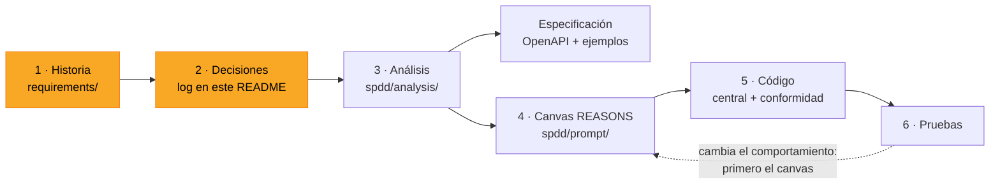
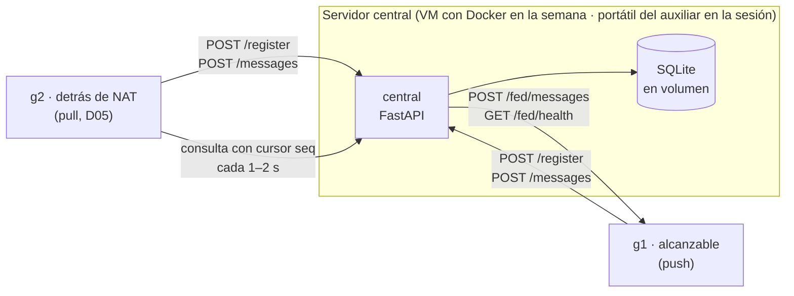

# Servidor central · Sistemas Distribuidos (UIS)

Servidor central del proyecto final de Sistemas Distribuidos (Escuela de Ingeniería de
Sistemas e Informática, UIS). Los servidores de chat de todos los grupos se registran en
él y, a través de él, conversan en una sola sala global, `#general`. Este repositorio
también publica la **especificación del protocolo** (OpenAPI y ejemplos JSON) y el
**script de conformidad** con el que cada grupo verifica su servidor, que son los
entregables que anuncia la sección 4 del enunciado.

El diseño está a cargo del auxiliar del proyecto, con aval del profesor, y se trabaja con
**SPDD** (Structured Prompt-Driven Development): se decide y se especifica antes de
escribir código, y cada decisión queda registrada en este README.

## Estado

> **Fase actual: decisiones (paso 2 de SPDD).** Está la [historia](requirements/) con
> HU1–HU12, sacada del [extracto del enunciado](requirements/enunciado/extracto.md).
> Hay 7 decisiones tomadas y 11 pendientes. **Todavía no hay especificación ni
> código.** Lo primero que se publica es la especificación, porque los grupos la
> necesitan para su etapa 3 (martes 17 de noviembre).

Amarillo: en curso.

## Qué se construye

Arquitectura en estrella, según la sección 2 del enunciado. Los servidores de grupo
nunca se hablan entre sí: todo pasa por el central. Cada grupo recibe de una de dos
formas:

- **Push**, que es lo que describe la sección 4: el central llama a
  `POST /fed/messages` de cada grupo registrado, excepto al de origen.
- **Pull**, el modo alternativo (D05): el central numera cada mensaje con `seq` y el
  grupo pide lo posterior a su último `seq`. Hace falta en la nube, donde el central no
  alcanza a los portátiles detrás de NAT.

Endpoints, según la sección 4 del enunciado (D01). Los detalles se fijan en la
especificación:

| Lado | Método y ruta | Qué hace |
|---|---|---|
| Central (lo llaman los grupos) | `POST /register` | Registrar o renovar `{"server": "gN", "url": "http://…"}` |
| Central (lo llaman los grupos) | `POST /messages` | Entregar un mensaje de un usuario del grupo; idempotente por `id` |
| Central (lo llaman los grupos) | `GET /history?since={lamport}` | Mensajes posteriores a una marca de Lamport |
| Central (lo llaman los grupos) | consulta con cursor `seq` | Modo alternativo (D05); nombre exacto en P06 |
| Central (lo llaman los grupos) | `GET /health` | Heartbeat del central |
| Grupo (lo llama el central) | `GET /fed/health` | Nombre del servidor y reloj de Lamport actual |
| Grupo (lo llama el central) | `POST /fed/messages` | Recibir un mensaje reenviado |

## Metodología: SPDD

SPDD es un método de Thoughtworks (Wei Zhang y Jessie Jie Xia, publicado en el sitio de
Martin Fowler en 2026) que trata los prompts como artefactos de ingeniería versionados
junto al código. El prompt estructurado se llama **canvas REASONS**: Requirements,
Entities, Approach, Structure, Operations, Norms y Safeguards. Reglas:

1. Primero la historia, después el análisis, después el canvas y solo entonces el
   código.
2. Cuando la realidad diverge, se corrige primero el canvas y después el código.
3. Cada decisión de este log dice a qué sección del canvas alimenta.

| Carpeta | Contenido |
|---|---|
| [`requirements/`](requirements/) | Historia CS-001 y el [extracto del enunciado](requirements/enunciado/extracto.md) |
| `spdd/analysis/` | Análisis (paso 3): todavía no existe |
| [`spdd/template/`](spdd/template/) | Plantilla del canvas REASONS |
| `spdd/prompt/` | Canvas (paso 4): todavía no existe |

Los archivos siguen el patrón `ID-AAAAMMDDhhmm-[Tipo]-descripcion.md`, con el prefijo `CS`
(servidor central).

## Log de decisiones

| ID | Decisión | Alternativas descartadas | Por qué | REASONS | Ronda |
|---|---|---|---|---|---|
| D01 | **El protocolo de la sección 4 del enunciado es la base.** Se respetan las rutas, el formato del mensaje y las reglas; se precisa lo que el resumen no dice (códigos, respuestas, vencimiento del registro, modo alternativo) y se extiende sin romper, con campos y rutas que un grupo puede ignorar | Rediseñar el protocolo con criterio libre | Los grupos ya programan sobre la sección 4; cambiarla a 5 días de la entrega obligaría a todos a rehacer trabajo | R, Safeguards | 1 |
| D02 | **Dos despliegues del mismo compose:** una VM en la nube durante la semana de pruebas y el portátil del auxiliar en la red de la sala para la sesión del jueves 19 | Solo en la red de la sala; solo en la nube | Los grupos prueban contra el central real toda la semana, y la sesión no depende de internet | S | 1 |
| D03 | **SPDD con los tres entregables del enunciado** (especificación OpenAPI, ejemplos JSON y script de conformidad), públicos en este repo. Stack: Python con FastAPI y SQLite en un volumen de Docker | Código directo con un log de decisiones | Es lo que promete el enunciado, y el stack es el que recomienda el curso, así que cualquier estudiante puede leer el código | N, S | 1 |
| D04 | **En la nube, una VM con Docker** que corre el mismo `docker compose up`, con HTTPS mediante Caddy | PaaS con volumen (Fly.io, Render, Railway); túnel desde el PC del auxiliar | El artefacto es idéntico en la nube y en la sala, y SQLite queda en un volumen normal | S | 1 |
| D05 | **Modo alternativo con cursor de secuencia.** El central numera con `seq` cada mensaje nuevo, en orden de llegada, y un grupo que no es alcanzable consulta cada 1–2 s lo posterior a su último `seq` | Consultar con `since={lamport}`; WebSocket o SSE desde el grupo | Es un campo extra que los demás ignoran (D01), y a diferencia de `since={lamport}` no pierde los mensajes concurrentes que llegan tarde con una marca menor. No pide código nuevo de conexión a los grupos | A, E | 1 |
| D06 | **Registro abierto:** cualquier nombre de servidor se puede registrar | Lista de grupos permitidos; token por grupo | Es lo más simple: no agrega requisitos a los grupos ni pasos de administración. Se acepta el riesgo de que un nombre choque con otro y de que aparezcan mensajes de prueba en `#general` | Safeguards | 1 |
| D07 | **Script de conformidad con dos partes.** La automática prueba `/fed/health` y `/fed/messages` del grupo. La guiada levanta un central de prueba que inyecta `5xx` y timeouts y le pide a la persona que envíe un mensaje | Solo la parte automática; checklist manual con curl | La API entre cliente y servidor de cada grupo es libre, así que el script no puede hacer enviar a un grupo por sí solo. La parte guiada cubre el envío, los reintentos y el registro, que pesan en la nota | O | 1 |

## Decisiones pendientes

| ID | Pregunta | Propuesta para discutir | Bloquea |
|---|---|---|---|
| P01 | ¿Qué proveedor de VM, qué dominio y cómo se emite el certificado? | Una VM pequeña con IP fija y un subdominio con Caddy, que obtiene el certificado solo | HU1, D04 |
| P02 | Reenvío push: ¿cuántos reintentos y con qué backoff por grupo, y qué pasa con un grupo caído mucho tiempo? | Una cola por grupo, backoff de 1 s a 30 s con jitter y sin bloquear a los demás. Tras N fallos de `/fed/health` el grupo queda caído, se deja de reenviarle y recupera con historial o cursor al volver | HU4, HU7 |
| P03 | ¿Cómo queda un grupo en push o en pull? | Campo opcional `mode` en `/register` (`push` por defecto, como en la sección 4). Un grupo en pull no recibe llamadas del central | HU2, HU6 |
| P04 | ¿Cuándo vence un registro sin renovar? | Tres veces el intervalo de renovación recomendado, publicado en la especificación | HU2 |
| P05 | ¿Qué valida el central en `POST /messages` y con qué código rechaza? | `400` con un mensaje claro si falta `id`, `from`, `origin` o `lamport`, si `lamport` no es entero o si el cuerpo supera un tamaño máximo. Así los errores de los grupos se ven pronto | HU3 |
| P06 | Nombres exactos: ¿el cursor es un parámetro de `/history` o una ruta nueva? ¿`since` es exclusivo? ¿`/history` devuelve una lista o un objeto? | `since` exclusivo; la respuesta, una lista de mensajes, cada uno con su `seq`; el cursor, un parámetro nuevo de `/history` | HU5, HU6, especificación |
| P07 | ¿Rutas de administración (ver grupos, reiniciar el historial, inyectar fallos) y panel de observación para la sesión? ¿Cómo se protegen? | Un panel web de solo lectura con grupos, estado y `#general`, y rutas de administración con un token del auxiliar | HU12 |
| P08 | ¿Cuándo se publican la versión 1 de la especificación y el central en la nube? | La especificación el domingo 15 y el central en la nube el lunes 16, antes de la etapa 3 de los grupos | HU8, todos los grupos |
| P09 | Transparencia: el auxiliar también es integrante de un grupo | Todo lo del protocolo se publica aquí y en el foro del curso a la vez para todos los grupos; ninguna aclaración llega a un grupo antes que a los demás | Norms |
| P10 | Idioma | Documentos y código en español; campos y rutas del protocolo en inglés, como en la sección 4 | Norms |
| P11 | Flujo de Git | Una rama y un PR por cosa terminada, Conventional Commits, nunca push directo a `main` (salvo el primer commit, que creó la rama) | Norms |

## Cómo continuar

Las instrucciones para cualquier persona o agente están en [`AGENTS.md`](AGENTS.md).

## Fuentes

- Enunciado del docente: [extracto](requirements/enunciado/extracto.md).
- Wei Zhang y Jessie Jie Xia (Thoughtworks), [Structured-Prompt-Driven Development (SPDD)](https://martinfowler.com/articles/structured-prompt-driven/), martinfowler.com, 2026.
- Leslie Lamport, *Time, Clocks, and the Ordering of Events in a Distributed System*, Communications of the ACM, 1978.
- Vitillo, *Understanding Distributed Systems*.
