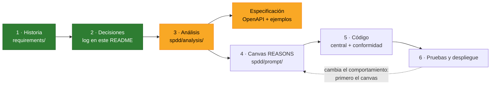
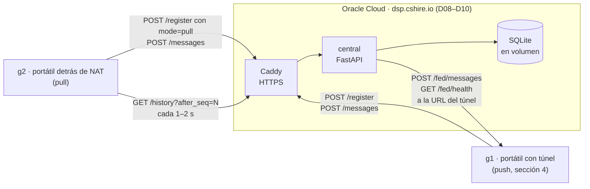

# Servidor central · Sistemas Distribuidos (UIS)

Servidor central del proyecto final de Sistemas Distribuidos (Escuela de Ingeniería de
Sistemas e Informática, UIS). Los servidores de chat de todos los grupos se registran en
él y, a través de él, conversan en una sola sala global, `#general`. Este repositorio
también publica la **especificación del protocolo** (OpenAPI y ejemplos JSON) y el
**script de conformidad** con el que cada grupo verifica su servidor, que son los
entregables que anuncia la sección 4 del enunciado.

El diseño está a cargo del auxiliar del proyecto, con aval del profesor, y se trabaja con
**SPDD** (Structured Prompt-Driven Development): se decide y se especifica antes de
escribir código, y cada decisión queda registrada en este README.

## Estado

> **Fase actual: análisis y especificación (paso 3 de SPDD).** Las rondas 1 y 2 de
> decisiones están cerradas: hay 22 decisiones y 2 pendientes que no bloquean. El
> objetivo de hoy, domingo 15 de noviembre (D18), es publicar la especificación v1 con
> sus ejemplos JSON, el central en `https://dsp.cshire.io` y la parte automática del
> script de conformidad. **Todavía no hay especificación ni código.**

Verde: hecho. Amarillo: en curso.

## Qué se construye

Arquitectura en estrella, según la sección 2 del enunciado. Los servidores de grupo
nunca se hablan entre sí: todo pasa por el central. El central corre siempre en la nube
(D10). Los grupos corren en sus portátiles, detrás de NAT, y reciben de una de dos
formas (D11):

- **Pull**, el modo para un portátil detrás de NAT (D05, D11): el grupo se registra con
  `"mode": "pull"`, el central no lo llama nunca, y el grupo pide cada 1–2 s los mensajes
  posteriores a su último `seq`.
- **Push**, lo que describe la sección 4 (D01): el grupo expone su servidor con un túnel
  (cloudflared o ngrok), registra esa URL y el central le hace `POST /fed/messages` con
  cada mensaje, excepto los suyos. Es el modo por defecto si el registro no trae `mode`.

Endpoints, según la sección 4 del enunciado (D01) con las extensiones de la ronda 2. Los
detalles se fijan en la especificación:

| Lado | Método y ruta | Qué hace |
|---|---|---|
| Central (lo llaman los grupos) | `POST /register` | Registrar o renovar `{"server": "gN", "url": "http://…"}`, con `"mode"` opcional (D11) |
| Central (lo llaman los grupos) | `POST /messages` | Entregar un mensaje de un usuario del grupo; idempotente por `id` (D12) |
| Central (lo llaman los grupos) | `GET /history?since={lamport}` | Mensajes con `lamport ≥ since`, ordenados por `(lamport, origin)` (D13, D14) |
| Central (lo llaman los grupos) | `GET /history?after_seq={seq}` | Modo pull: mensajes con `seq` mayor, en orden de llegada (D14) |
| Central (lo llaman los grupos) | `GET /health` | Heartbeat del central |
| Central (público) | `GET /` y `GET /servers` | Panel de observación y estado de los servidores en JSON (D17) |
| Central (auxiliar) | `/admin/…` | Rutas de administración con token (D17) |
| Grupo (lo llama el central) | `GET /fed/health` | Nombre del servidor y reloj de Lamport actual |
| Grupo (lo llama el central) | `POST /fed/messages` | Recibir un mensaje reenviado |

## Metodología: SPDD

SPDD es un método de Thoughtworks (Wei Zhang y Jessie Jie Xia, publicado en el sitio de
Martin Fowler en 2026) que trata los prompts como artefactos de ingeniería versionados
junto al código. El prompt estructurado se llama **canvas REASONS**: Requirements,
Entities, Approach, Structure, Operations, Norms y Safeguards. Reglas:

1. Primero la historia, después el análisis, después el canvas y solo entonces el
   código.
2. Cuando la realidad diverge, se corrige primero el canvas y después el código.
3. Cada decisión de este log dice a qué sección del canvas alimenta.

| Carpeta | Contenido |
|---|---|
| [`requirements/`](requirements/) | Historia CS-001 y el [extracto del enunciado](requirements/enunciado/extracto.md) |
| `spdd/analysis/` | Análisis (paso 3): en curso |
| [`spdd/template/`](spdd/template/) | Plantilla del canvas REASONS |
| `spdd/prompt/` | Canvas (paso 4): todavía no existe |

Los archivos siguen el patrón `ID-AAAAMMDDhhmm-[Tipo]-descripcion.md`, con el prefijo `CS`
(servidor central).

## Log de decisiones

| ID | Decisión | Alternativas descartadas | Por qué | REASONS | Ronda |
|---|---|---|---|---|---|
| D01 | **El protocolo de la sección 4 del enunciado es la base.** Se respetan las rutas, el formato del mensaje y las reglas; se precisa lo que el resumen no dice (códigos, respuestas, vencimiento del registro, modo alternativo) y se extiende sin romper, con campos y rutas que un grupo puede ignorar | Rediseñar el protocolo con criterio libre | Los grupos ya programan sobre la sección 4; cambiarla a 5 días de la entrega obligaría a todos a rehacer trabajo | R, Safeguards | 1 |
| D02 | **Dos despliegues del mismo compose:** una VM en la nube durante la semana de pruebas y el portátil del auxiliar en la red de la sala para la sesión del jueves 19. *Ajustada por D10* | Solo en la red de la sala; solo en la nube | Los grupos prueban contra el central real toda la semana, y la sesión no depende de internet | S | 1 |
| D03 | **SPDD con los tres entregables del enunciado** (especificación OpenAPI, ejemplos JSON y script de conformidad), públicos en este repo. Stack: Python con FastAPI y SQLite en un volumen de Docker | Código directo con un log de decisiones | Es lo que promete el enunciado, y el stack es el que recomienda el curso, así que cualquier estudiante puede leer el código | N, S | 1 |
| D04 | **En la nube, una VM con Docker** que corre el mismo `docker compose up`, con HTTPS mediante Caddy. *Ajustada por D08* | PaaS con volumen (Fly.io, Render, Railway); túnel desde el PC del auxiliar | El artefacto es idéntico en la nube y en la sala, y SQLite queda en un volumen normal | S | 1 |
| D05 | **Modo alternativo con cursor de secuencia.** El central numera con `seq` cada mensaje nuevo, en orden de llegada, y un grupo que no es alcanzable consulta cada 1–2 s lo posterior a su último `seq`. *Ajustada por D11* | Consultar con `since={lamport}`; WebSocket o SSE desde el grupo | Es un campo extra que los demás ignoran (D01), y a diferencia de `since={lamport}` no pierde los mensajes concurrentes que llegan tarde con una marca menor. No pide código nuevo de conexión a los grupos | A, E | 1 |
| D06 | **Registro abierto:** cualquier nombre de servidor se puede registrar | Lista de grupos permitidos; token por grupo | Es lo más simple: no agrega requisitos a los grupos ni pasos de administración. Se acepta el riesgo de que un nombre choque con otro y de que aparezcan mensajes de prueba en `#general` | Safeguards | 1 |
| D07 | **Script de conformidad con dos partes.** La automática prueba `/fed/health` y `/fed/messages` del grupo. La guiada levanta un central de prueba que inyecta `5xx` y timeouts y le pide a la persona que envíe un mensaje | Solo la parte automática; checklist manual con curl | La API entre cliente y servidor de cada grupo es libre, así que el script no puede hacer enviar a un grupo por sí solo. La parte guiada cubre el envío, los reintentos y el registro, que pesan en la nota | O | 1 |
| D08 | **La VM es una `VM.Standard.E2.1.Micro` (AMD, 1 GB) con Ubuntu 24.04 en la capa gratis de Oracle Cloud del auxiliar.** Lleva swap para construir las imágenes. Cierra P01 con D09 | Ampere A1 (ARM, más memoria, pero con capacidad intermitente en la región); EC2 en AWS; reutilizar otra VM | No cuesta nada, siempre hay capacidad y es x86 como el portátil, así que la imagen es la misma | S | 2 |
| D09 | **El central responde en `https://dsp.cshire.io`**, un subdominio de un dominio del auxiliar que no tiene otro uso, con un registro A sin proxy hacia la VM. Caddy obtiene el certificado solo. Cierra P01 | `sslip.io` con la IP; HTTP por IP | Un nombre estable y legible para todo el curso; si la IP cambia, solo cambia el registro A y los grupos no tocan su configuración | S | 2 |
| D10 | **El central corre siempre en la nube, también en la sesión del jueves 19.** El portátil del auxiliar corre el mismo compose solo como respaldo si falla internet en la sala. Ajusta D02 | Central en el portátil en la red de la sala para la sesión | Los grupos corren en sus portátiles y llegan al central por internet; lo que prueban en la semana es lo mismo que corre en la sesión. Las redes Wi-Fi universitarias suelen aislar a los clientes, así que el push en la sala tampoco estaba garantizado | S | 2 |
| D11 | **Cada grupo elige cómo recibe con un campo opcional `mode` en `POST /register`:** `"pull"` (el central no lo llama y el grupo consulta con el cursor `seq`) o `"push"` (el central llama a `POST /fed/messages` en la URL registrada, normalmente un túnel). Sin `mode` queda en push, como en la sección 4. Cierra P03 y ajusta D05: en la nube, pull es el modo normal | Solo pull; solo push con túnel obligatorio; URL vacía como señal de pull | Un portátil detrás de NAT no recibe llamadas, así que pull es lo práctico, pero un grupo que sigue la sección 4 al pie de la letra sigue funcionando con un túnel. Un campo explícito deja el estado claro en el panel | A, E | 2 |
| D12 | **`POST /messages` valida la forma y rechaza con `400`.** Obligatorios: `id`, `from`, `origin` y `lamport` (entero ≥ 0); `body` de hasta 10 000 caracteres. No exige que `id` sea UUID ni que `origin` esté registrado. La respuesta de error es `{"error", "detail"}`. Cierra P05 | Estricto (UUID, `from` = `usuario@origin`, origen registrado); laxo (solo `id` y `origin`) | Un `4xx` no se reintenta, así que el grupo pierde ese mensaje: se rechaza solo lo que de verdad no se puede guardar. Un grupo que envía antes de terminar de registrarse no pierde mensajes | R, Safeguards | 2 |
| D13 | **`since` es inclusivo:** `GET /history?since=N` devuelve los mensajes con `lamport ≥ N`. Cierra P06 con D14 | Exclusivo (`lamport > N`) | Un grupo que pide `since` = su última marca recibe también los mensajes concurrentes de otro origen con la misma marca; los repetidos los descarta la deduplicación por `id`, que es obligatoria. Funciona igual para quien supuso exclusivo | R, E | 2 |
| D14 | **`/history` devuelve una lista JSON de mensajes, cada uno con un campo extra `seq`.** El modo pull usa el mismo endpoint con `after_seq` (`seq` mayor, orden de llegada). `since` ordena por `(lamport, origin)`. Un parámetro `limit` (hasta 1000) permite paginar con el último `seq`. Cierra P06 | Objeto `{"messages", "last_seq"}`; ruta aparte `GET /messages?after_seq` | Una lista es lo que espera quien leyó la sección 4, y `seq` es un campo extra que se ignora (D01). Una sola ruta de lectura es más fácil de documentar | E, S | 2 |
| D15 | **Reenvío push con un cursor de entrega por grupo, guardado en SQLite.** Una tarea por grupo le envía en orden de `seq`. Un `5xx` o un timeout se reintenta con el mismo `id`, backoff de 1 a 30 s con jitter y sin tope; un `4xx` se salta y queda en el log. Heartbeat a `/fed/health` cada 5 s; con 3 fallos seguidos el grupo queda caído y se pausa, y al volver retoma desde su cursor. Cierra P02 | Cola en memoria con tope; un solo intento sin cola | Sobrevive a un reinicio del central, un grupo lento no frena a los demás y un grupo que vuelve recibe lo que se perdió sin pedirlo | A, O, Safeguards | 2 |
| D16 | **El registro no vence.** El heartbeat decide quién está vivo en push; en pull, la señal de vida es la última consulta o renovación. Volver a registrarse con el mismo nombre actualiza la URL y el modo y conserva el cursor. Los registros de prueba se sacan con la ruta de administración (D17). Cierra P04 | Vencer a los 90 s sin renovar; vencer a los 10 min | Es lo más simple de operar y nunca deja a un grupo fuera por una renovación tardía. Las URL de túnel que cambian se corrigen al renovar | E, A | 2 |
| D17 | **Panel de observación de solo lectura en `/` y estado en `GET /servers`, públicos, y rutas `/admin/…` protegidas con un token del auxiliar** para sacar un servidor y reiniciar el historial. El token va por variable de entorno y nunca entra al repositorio. Cierra P07 | Panel sin rutas de administración; solo logs | En la sesión el profesor y el curso ven de un vistazo qué grupos están vivos y qué pasa en `#general`; las rutas de administración evitan entrar a la VM para limpiar el historial de la semana | S, Safeguards | 2 |
| D18 | **Hoy, domingo 15, se publican la especificación v1 con los ejemplos JSON, el central en la nube y la parte automática del script de conformidad**, y se anuncian en el foro a todos a la vez. Cierra P08 | Script el lunes 16 o el martes 17 | Los grupos tienen el lunes y el martes para su etapa 3 con todo el contrato y la prueba en la mano | O | 2 |
| D19 | **Transparencia:** todo lo del protocolo se publica en este repositorio y en el foro del curso a la vez para todos los grupos; ninguna aclaración llega a un grupo antes que a los demás. Cierra P09 | — | El auxiliar también es integrante de un grupo | Norms | 2 |
| D20 | **Idioma:** documentos y código en español; campos y rutas del protocolo en inglés, como en la sección 4. Cierra P10 | — | Es el idioma del curso, y el protocolo ya está en inglés en el enunciado | Norms | 2 |
| D21 | **Flujo de Git:** una rama y un PR por cosa terminada, con Conventional Commits; nunca push directo a `main`, salvo el primer commit, que creó la rama. Cierra P11 | — | Cada cambio queda revisable y el registro de cambios de la especificación sale de los PR | Norms | 2 |
| D22 | **Una sola aprobación antes del código:** el análisis, la especificación con los ejemplos y los canvas del central y del script se revisan juntos; aprobados, se escriben código, pruebas y despliegue | Dos aprobaciones (contrato y luego canvas); aprobar al final en el PR | Es lo más rápido que respeta la regla 1 de [`AGENTS.md`](AGENTS.md) y permite publicar hoy (D18) | O | 2 |

## Decisiones pendientes

| ID | Pregunta | Propuesta para discutir | Bloquea |
|---|---|---|---|
| P12 | ¿Cuándo se publica la parte guiada del script de conformidad (el central de prueba que inyecta fallos, D07)? | El lunes 16, para que los grupos la usen en su etapa 3 | HU9 |
| P13 | ¿Se reinicia el historial antes de la sesión del jueves 19? | Sí, el miércoles 18 por la noche con la ruta de administración, anunciado a todos los grupos (D19) | HU11 |

## Cómo continuar

Las instrucciones para cualquier persona o agente están en [`AGENTS.md`](AGENTS.md).

## Fuentes

- Enunciado del docente: [extracto](requirements/enunciado/extracto.md).
- Wei Zhang y Jessie Jie Xia (Thoughtworks), [Structured-Prompt-Driven Development (SPDD)](https://martinfowler.com/articles/structured-prompt-driven/), martinfowler.com, 2026.
- Leslie Lamport, *Time, Clocks, and the Ordering of Events in a Distributed System*, Communications of the ACM, 1978.
- Vitillo, *Understanding Distributed Systems*.
