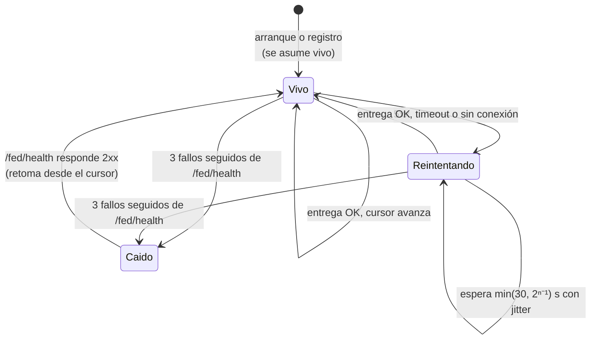
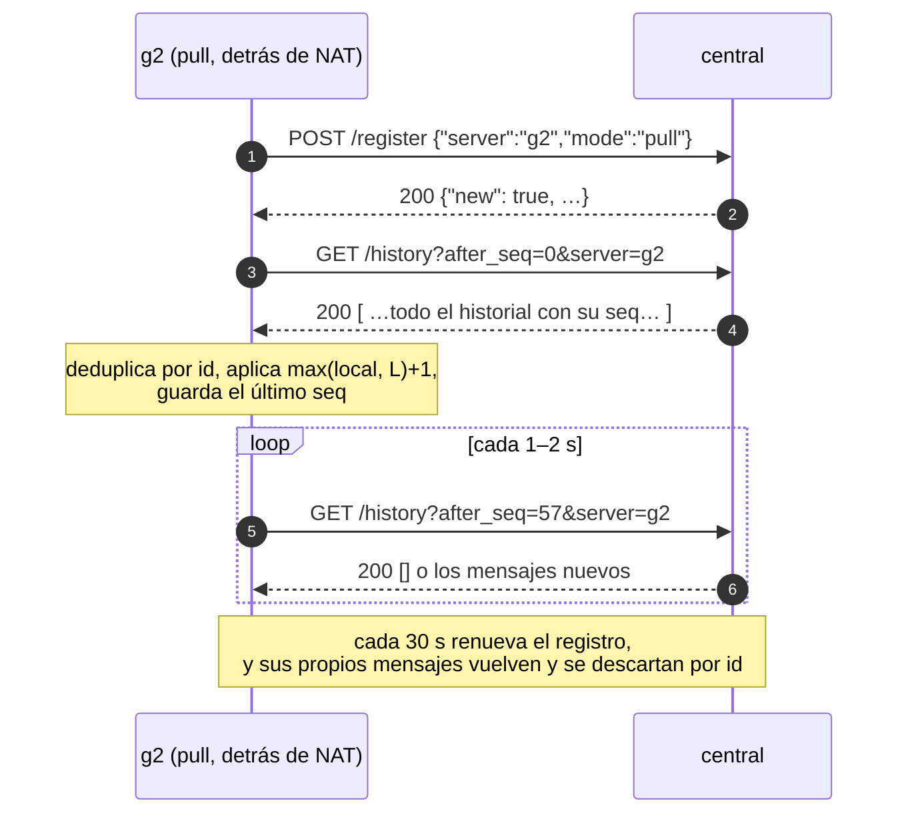
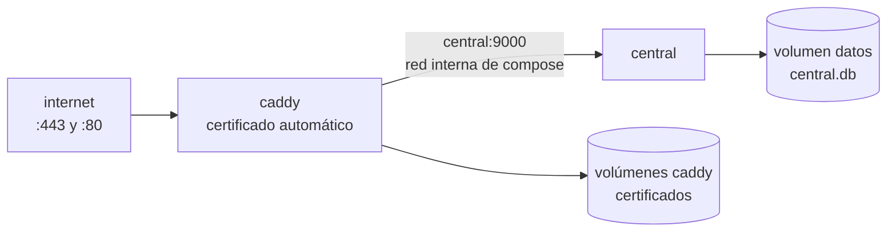

# CS-002 · Análisis: protocolo y servidor central

| Campo | Valor |
|---|---|
| ID | CS-002 |
| Tipo | Análisis (paso 3 de SPDD) |
| Historia | [CS-001](../../requirements/CS-001-202611142129-[Story]-servidor-central.md) |
| Decisiones | D01–D22 del [log](../../README.md#log-de-decisiones) |
| Estado | Aprobado (D23): las propuestas A1–A16 quedan como decisión |
| Fecha | 2026-11-15 |

Este análisis fija el contrato de cada ruta, que es lo que la especificación OpenAPI
pasa a formato máquina, y el comportamiento interno del central, que es lo que el canvas
CS-003 convierte en código. Lo que aquí aparece como **propuesta A1–A12** no estaba en
ninguna decisión: al aprobar este análisis, el auxiliar las convierte en D23. Las
A13–A16 salieron al pasar el análisis a OpenAPI, que obligó a precisar lo ambiguo.

## 1. Principio

**Estricto al enviar, tolerante al recibir**, sin romper la sección 4 (D01):

- el central nunca envía un campo con otro nombre o tipo que los de la sección 4, y lo
  que agrega (`seq`) es un campo extra que se puede ignorar;
- el central acepta todo mensaje que pueda guardar y rechaza con `400` solo lo que no
  puede (D12), porque un `4xx` no se reintenta y el grupo pierde ese mensaje;
- los campos desconocidos se ignoran sin error, en las dos direcciones.

## 2. El mensaje

| Campo | Tipo | Obligatorio | Límite | Qué hace el central |
|---|---|---|---|---|
| `id` | texto | sí | 1–100 caracteres | Clave de deduplicación. Se recomienda UUID, pero no se exige (D12) |
| `from` | texto | sí | 1–100 caracteres | Se guarda y se reenvía tal cual; la forma `usuario@gN` es recomendada, no exigida |
| `origin` | texto | sí | 1–32 caracteres | Nombre del servidor de origen; el central no le reenvía a ese servidor |
| `lamport` | entero JSON | sí | 0 a 2⁵³ − 1 (A9) | Se guarda tal cual; ordena el historial |
| `sent_at` | texto | no (`""` si no viene, A13) | hasta 64 caracteres | Informativo; no se valida el formato ni se usa para ordenar |
| `body` | texto | no (`""` si no viene, A13) | hasta 10 000 caracteres | Se guarda y se reenvía tal cual |
| `seq` | entero | lo pone el central | ≥ 1 | Número de llegada al central, sin huecos y sin retroceso (D05, A7) |

- `lamport` debe ser un número entero: `42` sí, y `42.0` se acepta como `42`, porque
  JSON Schema lo trata como entero (A15). `"42"`, `42.5` o `true` no. Un texto que parece
  número se rechaza para que el grupo lo corrija pronto, y no para que llegue convertido
  a los demás.
- Un campo obligatorio ausente, vacío o de otro tipo responde `400` (D12). Un opcional
  con `null` o de otro tipo también: `sent_at` y `body` son siempre texto.
- Solo se guardan los seis campos de la sección 4. Los desconocidos se ignoran: no se
  guardan ni se reenvían (A13).
- El tope de 2⁵³ − 1 es el mayor entero que un cliente en JavaScript lee sin perder
  precisión (A9).

## 3. Rutas del central (las llaman los grupos)

Todas reciben y devuelven JSON. Los errores tienen siempre la forma:

```json
{"error": "mensaje inválido", "detail": [{"field": "lamport", "problem": "debe ser un entero ≥ 0"}]}
```

### 3.1 `POST /register`

| Campo | Obligatorio | Regla |
|---|---|---|
| `server` | sí | `^[A-Za-z0-9_-]{1,32}$`, distingue mayúsculas (A5) |
| `url` | en push | Hasta 2048 caracteres. En push, URL absoluta `http` o `https`, sin la `/` final. En pull es opcional e informativa y no se valida, porque el central nunca la llama (A14) |
| `mode` | no | `"push"` (por defecto, sección 4) o `"pull"` (D11) |

| Caso | Respuesta | Efecto |
|---|---|---|
| Nombre nuevo | `200` `{"server", "url", "mode", "new": true}` | Se crea el registro. En push, el cursor de entrega arranca en el último `seq` existente (A6): lo anterior se recupera con `/history` |
| Nombre conocido | `200` `{…, "new": false}` | Se actualizan `url` y `mode`, y se conserva el cursor (D16) |
| Pasa de pull a push | `200` | El cursor arranca en el último `seq` existente (A6) |
| Falta `server`, nombre inválido, `mode` desconocido o push sin `url` válida | `400` | Ninguno |
| URL de push a una dirección privada, en la nube | `400` | Ninguno (A2) |
| Ya hay 100 servidores y el nombre es nuevo | `400` | Ninguno (A1) |

El registro no vence (D16). La especificación recomienda renovar cada 30 s igual: así una
URL de túnel que cambió se corrige sola, y en pull la renovación cuenta como señal de vida.

### 3.2 `POST /messages`

| Caso | Respuesta | Efecto |
|---|---|---|
| `id` nuevo y válido | `200` `{"id", "seq", "duplicate": false}` | Se guarda con el siguiente `seq` y se despierta el reenvío push |
| `id` ya conocido | `200` `{"id", "seq", "duplicate": true}`, con el `seq` original | Ninguno. Si el contenido difiere, gana el primero y queda en el log (A4) |
| Mensaje inválido o JSON mal formado | `400` con `detail` | Ninguno |

- No hace falta estar registrado para enviar (D12). Un grupo que envía antes de terminar
  su registro no pierde mensajes.
- La deduplicación es atómica: dos `POST` simultáneos con el mismo `id` dejan un solo
  mensaje, y los dos reciben `200`.

### 3.3 `GET /history`

| Parámetro | Regla |
|---|---|
| `since` | Entero de 0 a 2⁵³ − 1. Mensajes con `lamport ≥ since` (inclusivo, D13), ordenados por `(lamport, origin, id)` |
| `after_seq` | Entero de 0 a 2⁵³ − 1. Mensajes con `seq > after_seq`, ordenados por `seq` (D14). Es el modo pull |
| `limit` | Entero de 1 a 1000; por defecto 1000 (D14) |
| `server` | Opcional. Nombre del servidor que consulta; en pull es su señal de vida para el panel (A3). No se valida: un nombre no registrado se ignora (A16) |

- `since` y `after_seq` juntos responden `400`. Sin ninguno de los dos equivale a
  `since=0`.
- La respuesta es siempre una **lista JSON** de mensajes, cada uno con su `seq`. Una
  lista vacía es `[]`, no un `404`.
- Para paginar se usa `after_seq`: se repite con el último `seq` recibido mientras la
  lista llegue llena. Con `since`, `limit` devuelve los primeros mensajes en orden de
  marca. Repetir con la última marca funciona porque es inclusivo, pero si toda la
  página tuviera la misma marca, devolvería la misma página. Por eso la especificación
  recomienda `after_seq` para recorrer historiales grandes.
- Desempate: la sección 4 ordena por `(lamport, origin)`. El central agrega `id` como
  tercer criterio para que dos mensajes con la misma marca y el mismo origen, que solo
  aparecen si un grupo tiene un error en su reloj, salgan siempre en el mismo orden.

**Por qué el modo pull usa `seq` y no `lamport`.** Si `g1` envía con marca 40 justo
después de que `g2` consultó `since=41`, `g2` nunca vuelve a pedir la marca 40 y pierde
ese mensaje. `seq` es el orden de llegada al central: un mensaje que llega tarde recibe
un `seq` mayor que todo lo que `g2` ya vio, así que la siguiente consulta lo trae. El
orden de **presentación** sigue siendo `(lamport, origin)`: el grupo inserta cada
mensaje en su lugar.

### 3.4 `GET /health`

`200` `{"status": "ok", "spec_version": "1.0.0", "last_seq": 57}`, sin tocar la red. Un
grupo que no recibe `200` en su tiempo de espera cuenta un fallo (requisito 8).

### 3.5 Panel y estado: `GET /` y `GET /servers` (D17)

- `GET /servers` devuelve `{"last_seq": N, "servers": [...]}`; cada servidor trae
  `server`, `mode`, `url`, `state`, `registered_at`, `last_seen`, `lamport`,
  `delivered_seq` y `pending`.
- `state` es `"up"` o `"down"`.
  - En push, el heartbeat decide (§5).
  - En pull, es `"up"` si hubo una consulta o un registro en los últimos 60 s.
- `lamport` es el último reloj que reportó el `/fed/health` del grupo.
- `delivered_seq` y `pending` solo tienen valor en push; en pull son `null`.
- `pending` cuenta los mensajes con `seq > delivered_seq` que no son del propio
  servidor.
- `registered_at` es el primer registro con ese nombre. `last_seen` es la última señal
  de vida, o `null` si no hubo ninguna.
- Todas las fechas son ISO 8601 en UTC con milisegundos.
- `GET /` es una página HTML sin dependencias externas. Cada 2 s consulta `/servers` y
  `/history?after_seq=…`, y muestra la tabla de servidores y `#general` en orden
  `(lamport, origin)`, con el origen de cada mensaje.

### 3.6 Administración: `/admin/…` (D17)

Exigen `Authorization: Bearer <ADMIN_TOKEN>`. El token se compara en tiempo constante.
Sin token configurado, todas responden `403`. Los errores que no corresponden a un campo
(`401`, `403`, `404`, JSON mal formado) llevan `detail: []`.

| Ruta | Respuesta | Efecto |
|---|---|---|
| `DELETE /admin/servers/{server}` | `200` `{"removed": "g3"}`; `404` si no existe | Borra el registro y su cursor; su tarea de reenvío se detiene |
| `POST /admin/reset` | `200` `{"deleted": N, "last_seq": M}` | Borra el historial. `seq` **no** vuelve a empezar (A7): un grupo en pull con `after_seq = 500` sigue recibiendo los mensajes nuevos |
| Token ausente o incorrecto | `401` | Ninguno |

## 4. Rutas de los grupos (las llama el central)

| Ruta | Lo que el central envía | Lo que espera |
|---|---|---|
| `GET {url}/fed/health` | Nada | `2xx` con `{"server", "lamport"}`, como pide la sección 4 y comprueba el script. Para el heartbeat basta el código: cualquier `2xx` es vivo, y cualquier otra respuesta, o ninguna en 3 s, es fallo (A11). Si el cuerpo trae un `lamport` entero, se publica en `/servers`; `server` no se compara con el nombre registrado |
| `POST {url}/fed/messages` | Los seis campos de la sección 4 tal como se guardaron, más `seq` (A10, A13) | `2xx` con cualquier cuerpo: entregado. `4xx`: rechazado, no se reintenta. `5xx`, timeout o error de conexión: se reintenta |

El grupo aplica `max(local, recibido) + 1` y descarta por `id`, igual que con lo que
recibe por `/history` (sección 4).

## 5. Reenvío push (D15)

Cada servidor en push tiene una tarea propia y un cursor `delivered_seq` en SQLite.



1. La tarea toma el siguiente mensaje con `seq > delivered_seq`. Si es del propio
   servidor (`origin` igual a su nombre), avanza el cursor sin enviarlo.
2. Con `2xx` avanza el cursor. Con `4xx` registra `RECHAZADO_4XX`, avanza el cursor y
   sigue con el siguiente: un mensaje que el grupo rechaza no debe bloquear el resto.
3. Con `5xx`, timeout o error de conexión, reintenta **el mismo mensaje con el mismo
   `id`**. Espera `min(30, 1 · 2ⁿ⁻¹)` s con jitter igual (la mitad fija y la otra mitad
   al azar), sin tope de intentos.
4. Mientras el servidor está caído, la tarea no intenta entregar: espera a que el
   heartbeat lo vea vivo y entonces reinicia el backoff.
5. Sin mensajes pendientes, la tarea duerme hasta que llega uno nuevo; no consulta en
   bucle.

El heartbeat consulta `/fed/health` cada 5 s, con 3 s de tiempo de espera. Tres fallos
seguidos marcan el servidor como caído y registran `GRUPO_CAIDO`; el primer `2xx` lo marca
vivo y registra `GRUPO_VOLVIO` con el tiempo que estuvo caído. Solo se registran los
cambios de estado, no cada fallo. Un servidor en pull no recibe heartbeat.

Al reiniciar el central, cada tarea retoma desde el cursor guardado: el reenvío sobrevive
al reinicio. Las tareas son independientes, así que un grupo lento o caído no frena a los
demás.

## 6. Cómo recibe un grupo



- **Pull** (lo normal en la nube): el ciclo de arriba. El grupo guarda su último `seq`
  en su base, así que tras reiniciarse no pide todo de nuevo.
- **Push** (sección 4 al pie de la letra): el grupo expone su servidor con un túnel, por
  ejemplo `cloudflared tunnel --url http://localhost:8000`, registra la URL pública que le
  da el túnel y recibe en `/fed/messages`. Como la URL del túnel cambia en cada
  arranque, renovar el registro con la URL actual es obligatorio en la práctica.
- En los dos modos, al arrancar y al volver de una caída del central, el grupo recupera
  con `/history` (requisito 9).

## 7. Persistencia

SQLite en el volumen `/datos`. El acceso sigue el mismo patrón que el servidor del grupo:
una conexión por operación, WAL y `BEGIN IMMEDIATE` en las escrituras.

| Tabla | Campos | Notas |
|---|---|---|
| `mensajes` | `seq` (PK `AUTOINCREMENT`), `id` (UNIQUE), `remitente`, `origin`, `lamport`, `sent_at`, `body`, `recibido_en` | `AUTOINCREMENT` impide que `seq` se reutilice, incluso después de `/admin/reset` (A7). Índice por `(lamport, origin, id)` |
| `servidores` | `nombre` (PK), `url`, `modo`, `registrado_en`, `renovado_en`, `visto_en`, `entregado_seq`, `lamport` | `entregado_seq` es el cursor push; `visto_en`, la última señal de vida |

La deduplicación es un `INSERT … SELECT … WHERE NOT EXISTS (… WHERE id = ?)` dentro de
`BEGIN IMMEDIATE`, con `UNIQUE(id)` como respaldo: si no insertó, se lee el `seq` original
para responder. No se usa `ON CONFLICT (id) DO NOTHING` porque, con `AUTOINCREMENT`, el
insert ignorado consume un `seq` igual y deja huecos (comprobado con SQLite 3.54).

## 8. Eventos del log (HU10)

Una línea por evento, con el mismo formato que los servidores de grupo:
`2026-11-15T14:03:22.104Z central EVENTO clave=valor …`.

| Evento | Cuándo | Datos |
|---|---|---|
| `ARRANQUE` / `PARADA` | Al iniciar y al terminar | `mensajes`, `servidores`, `ultimo_seq` |
| `REGISTRADO` / `RENOVADO` | `POST /register` aceptado | `server`, `mode`, `url` |
| `REGISTRO_RECHAZADO` | `POST /register` con `400` | `motivo` |
| `RECIBIDO` | Mensaje nuevo guardado | `id`, `lamport`, `origin`, `from`, `seq` |
| `DUPLICADO_DESCARTADO` | `id` ya conocido | `id`, `origin`, `distinto` (si el contenido difiere) |
| `RECHAZADO_400` | `POST /messages` inválido | `origin` (si vino), `motivo` |
| `REENVIADO` | Entrega push con `2xx` | `id`, `seq`, `destino`, `ms` |
| `REINTENTO` | Entrega push fallida que se reintenta | `id`, `destino`, `intento`, `espera_s`, `causa` |
| `RECHAZADO_4XX` | El grupo respondió `4xx` | `id`, `destino`, `codigo` |
| `GRUPO_CAIDO` / `GRUPO_VOLVIO` | Cambio de estado por heartbeat | `destino`, `caido_s` |
| `HISTORIAL_SERVIDO` | `/history` con al menos un mensaje | `server`, `since` o `after_seq`, `n` |
| `ADMIN` | Ruta de administración usada | `accion`, `server` o `borrados` |

Con estos eventos se reconstruye todo lo que pasó con un `id`: `RECIBIDO`, un
`REENVIADO` por cada servidor en push y los `HISTORIAL_SERVIDO` de los que lo pidieron.

## 9. Parámetros

| Variable | Por defecto | Uso |
|---|---|---|
| `ADMIN_TOKEN` | vacío (administración deshabilitada) | Token de `/admin/…` (D17). Nunca entra al repositorio |
| `RUTA_BD` | `/datos/central.db` | Base SQLite en el volumen |
| `PUERTO` | `9000` | Puerto interno del central |
| `HEARTBEAT_INTERVALO_S` | `5` | Periodo del heartbeat push (D15) |
| `HEARTBEAT_FALLOS_PARA_CAIDO` | `3` | Fallos seguidos para marcar caído (D15) |
| `BACKOFF_BASE_S` / `BACKOFF_MAX_S` | `1` / `30` | Espera de los reintentos push (D15) |
| `HTTP_TIMEOUT_S` | `3` | Tiempo de espera hacia los grupos |
| `MAX_SERVIDORES` | `100` | Tope de registros (A1) |
| `PERMITIR_URL_PRIVADAS` | `false` | `true` solo en el portátil de respaldo, donde los grupos están en la misma red (A2) |
| `DOMINIO` | `dsp.cshire.io` | Nombre con el que Caddy pide el certificado (D09) |

## 10. Seguridad y abuso

El registro es abierto (D06) y el central es público, así que estos límites protegen el
servicio sin pedirles nada a los grupos:

- **A1 · Tope de servidores.** Con 100 registros, uno nuevo responde `400`. Sin tope,
  alguien podría registrar miles de URL muertas, y cada una tendría su tarea de reenvío
  y su heartbeat.
- **A2 · Sin URL privadas en la nube.** Como cualquiera registra una URL y el central la
  llama, se rechazan las que resuelven a direcciones de loopback, privadas o de enlace
  local (por ejemplo `169.254.169.254`, el servicio de metadatos de la VM). Se comprueba
  al registrar y antes de cada llamada, porque el DNS puede cambiar. En el portátil de
  respaldo se desactiva con `PERMITIR_URL_PRIVADAS=true`.
- **Tamaños.** Caddy corta los cuerpos de más de 1 MB con `413`, y el central valida
  10 000 caracteres de `body`.
- **Administración.** Las rutas exigen el token y se registran en el log. El token vive
  en el `.env` de la VM (permisos `600`) y en `~/.config/sakura/` del auxiliar.
- **Sin cookies ni CORS.** Los clientes de los grupos hablan solo con su propio servidor
  (sección 2), así que el central no necesita aceptar peticiones de navegadores de otros
  orígenes.

## 11. Despliegue



- Un `docker-compose.yml` con dos servicios: `central` y `caddy` (perfil `nube`).
  - En el portátil basta `docker compose up`: el central queda en el puerto 9000 y sin
    Caddy.
  - En la VM se usa `docker compose --profile nube up -d`, con el puerto 9000 publicado
    solo en `127.0.0.1`.
- La VM de Oracle (D08) necesita:
  - los puertos 80 y 443 abiertos en la lista de seguridad y en el `iptables` de la
    imagen de Ubuntu, que los bloquea por defecto;
  - 2 GB de swap, porque tiene 1 GB de RAM;
  - Docker con el plugin de compose.
- El código llega con `git clone` del repositorio público, y la imagen se construye en
  la VM.

## 12. Script de conformidad: parte automática (D07, D18)

Corre en Docker contra la URL del servidor del grupo y deja un informe de texto. Los
mensajes de prueba usan `origin` `conformidad` y un `body` que dice que se pueden
ignorar (A12).

| # | Caso | Pasa si | Severidad |
|---|---|---|---|
| 1 | `GET /fed/health` | `2xx` con `server` (texto) y `lamport` (entero ≥ 0) | Obligatorio |
| 2 | `POST /fed/messages` con un mensaje nuevo y marca `L + 100`, donde `L` es el reloj del caso 1 | `2xx` | Obligatorio |
| 3 | `GET /fed/health` después del caso 2 | `lamport ≥ L + 101`: aplicó `max(local, recibido) + 1` | Obligatorio |
| 4 | Repetir el mensaje del caso 2, mismo `id` | `2xx` | Obligatorio |
| 5 | `GET /fed/health` después del duplicado | El reloj no cambió: el duplicado no tuvo efectos | Advertencia, porque otra actividad del grupo también mueve el reloj |
| 6 | Mensaje nuevo con campos desconocidos | `2xx` | Obligatorio |
| 7 | Mensaje nuevo con marca 1, menor que el reloj | `2xx` y el reloj sube en exactamente 1 | Obligatorio el `2xx`; advertencia el +1 |
| 8 | Mensaje sin `id` | `4xx`: ni `2xx` (lo aceptó) ni `5xx` (se cayó) | Advertencia: la sección 4 no lo exige |
| 9 | Tiempo de respuesta de cada llamada | Menos de 3 s, el tiempo de espera del central | Obligatorio |

El script sale con código `0` si pasan todos los obligatorios. En Linux corre con
`--network host`; en Docker Desktop (Windows y macOS) se usa
`http://host.docker.internal:PUERTO`.

## 13. Propuestas para aprobar (A1–A12)

| ID | Propuesta | Sección |
|---|---|---|
| A1 | Tope de 100 servidores registrados | §10 |
| A2 | URL privadas rechazadas en la nube, permitidas en el portátil de respaldo | §10 |
| A3 | Parámetro opcional `server` en `/history` como señal de vida en pull | §3.3 |
| A4 | Con un `id` repetido y contenido distinto, gana el primero y queda en el log | §3.2 |
| A5 | Nombre de servidor `^[A-Za-z0-9_-]{1,32}$`, que distingue mayúsculas | §3.1 |
| A6 | Un servidor que entra en push arranca su cursor en el último `seq`; lo anterior lo recupera con `/history` | §3.1 |
| A7 | `seq` nunca se reutiliza, ni siquiera después de `/admin/reset` | §3.6, §7 |
| A8 | Todo éxito responde `200`: registro nuevo o renovado, mensaje nuevo o duplicado | §3 |
| A9 | `lamport` de 0 a 2⁵³ − 1, entero JSON estricto | §2 |
| A10 | El central reenvía en push el mensaje con `seq` agregado | §4 |
| A11 | El heartbeat cuenta como vivo solo un `2xx` | §4, §5 |
| A12 | Los mensajes del script de conformidad usan `origin` `conformidad` | §12 |
| A13 | Solo se guardan y reenvían los seis campos de la sección 4; `sent_at` y `body` ausentes viajan como `""`, nunca `null` | §2, §4 |
| A14 | En pull, `url` es opcional, no se valida y no pasa por el filtro de A2 | §3.1 |
| A15 | `lamport` `42.0` se acepta como `42`, igual que en JSON Schema | §2 |
| A16 | El parámetro `server` de `/history` no se valida; un nombre no registrado se ignora | §3.3 |

## 14. Fuera de este análisis

- La parte guiada del script de conformidad, con un central de prueba que inyecta fallos
  (P12).
- El reinicio del historial antes de la sesión (P13); la ruta para hacerlo sí está aquí.
