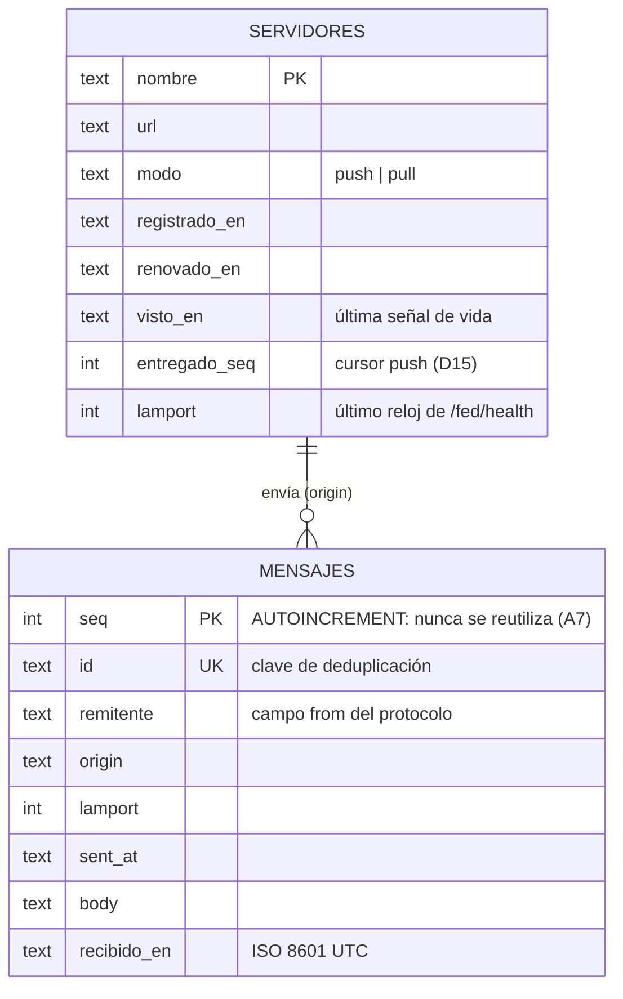

# CS-003 · Canvas REASONS: servidor central

| Campo | Valor |
|---|---|
| ID | CS-003 |
| Historia | [CS-001](../../requirements/CS-001-202611142129-[Story]-servidor-central.md), HU1–HU7, HU10–HU12 |
| Análisis | [CS-002](../analysis/CS-002-202611150918-[Analysis]-protocolo-y-central.md) |
| Especificación | [`especificacion/openapi-central.yaml`](../../especificacion/openapi-central.yaml) |
| Estado | Aprobado (D23) |
| Revisado por | Javier Chacón, auxiliar, 2026-11-15 |

## R · Requirements (requisitos)

Un servidor central que cumple la especificación v1 y corre igual en la VM y en el
portátil. Está terminado cuando:

1. `docker compose up` levanta el central en un equipo limpio en el puerto 9000, y
   `docker compose --profile nube up -d` lo levanta en la VM detrás de Caddy, en
   `https://dsp.cshire.io` (D08, D09).
2. `POST /register` registra o renueva, con `mode` push o pull, y responde `400` en cada
   caso inválido de CS-002 §3.1. Eso incluye el tope de servidores (A1) y las URL de push
   privadas en la nube (A2); en pull, la `url` no se valida (A14).
3. `POST /messages` guarda un mensaje nuevo con el siguiente `seq` y responde
   `{"id", "seq", "duplicate": false}`. Un `id` repetido responde `200` con
   `"duplicate": true` y el `seq` original, sin efectos. Lo inválido responde `400` con
   `{"error", "detail"}` (D12).
4. `GET /history` cumple CS-002 §3.3:
   - `since` inclusivo, en orden `(lamport, origin, id)` (D13);
   - `after_seq` en orden de `seq`;
   - `limit`;
   - `400` si llegan `since` y `after_seq` juntos;
   - siempre una lista (D14).
5. `GET /health` responde `{"status", "spec_version", "last_seq"}` sin tocar la red.
6. Reenvío push (D15), según CS-002 §5:
   - cada servidor en push recibe en `POST {url}/fed/messages` todos los mensajes que no
     son suyos, en orden de `seq`;
   - reintenta `5xx` y timeouts con el mismo `id` y backoff;
   - salta los `4xx`;
   - se pausa cuando el servidor está caído y retoma desde el cursor, también después de
     reiniciar el central.
7. El heartbeat marca un servidor como caído tras 3 fallos seguidos de `/fed/health` y
   como vivo con el primer `2xx`.
8. `GET /servers` y el panel en `GET /` muestran los servidores, su estado y `#general`
   (D17).
9. `/admin/servers/{server}` y `/admin/reset` exigen el token. Sin token configurado
   responden `403`. `seq` no se reutiliza después del reinicio (A7).
10. Cada evento de CS-002 §8 deja una línea en el log.
11. Los datos sobreviven a `docker compose restart`.
12. Las pruebas pasan dentro del contenedor (`docker compose run --rm pruebas`). Eso
    incluye una prueba de contrato: los ejemplos JSON y las respuestas reales validan
    contra los esquemas de la especificación.

## E · Entities (entidades)



- **`Mensaje`** (Pydantic, entrada): `id`, `from_` con alias `from`, `origin`,
  `lamport`, `sent_at` y `body`. Usa `extra="ignore"` (A13) y es inmutable; sus límites
  son los de CS-002 §2.
  - `lamport` es un entero de 0 a 2⁵³ − 1 con un validador previo: acepta `42.0` como
    `42` (A15) y rechaza texto, booleanos y decimales.
  - `sent_at` y `body` son texto estricto, con `""` por defecto.
- **`MensajeGuardado`**: `Mensaje` más `seq`. Es lo que devuelve `/history` y lo que viaja
  en push (A10).
- **`Registro`** (entrada): `server` (patrón de A5), `url` (opcional), `mode`
  (`push`/`pull`, por defecto `push`).
- **`Servidor`** (dataclass): una fila de `SERVIDORES` más el estado en memoria del
  heartbeat: `vivo`, `fallos_seguidos` y `caido_desde`.
- **Respuestas**: `AcuseMensaje` (`id`, `seq`, `duplicate`), `RespuestaRegistro`
  (`server`, `url`, `mode`, `new`), `Salud`, `EstadoServidores` y `Error`
  (`error`, `detail[]`). Cada una coincide campo por campo con la especificación.

## A · Approach (enfoque)

1. **El mismo stack y los mismos patrones que el servidor de los grupos (D03)**: FastAPI,
   SQLite con una conexión por operación, WAL y `BEGIN IMMEDIATE`, y logs de una línea
   por evento. Un estudiante que leyó el código de su grupo lee este sin sorpresas.
2. **La especificación manda.** Los modelos de Pydantic copian sus límites. Una prueba de
   contrato valida los ejemplos y las respuestas reales contra el YAML, así que una
   diferencia entre código y especificación rompe una prueba, no a un grupo.
3. **Errores en `400` con un solo manejador.** El `RequestValidationError` de FastAPI,
   que por defecto es `422`, se traduce a `400` con `{"error", "detail": [{field,
   problem}]}` y un problema en español por campo (D12). Lo mismo vale para el JSON mal
   formado y los parámetros de consulta inválidos.
4. **SQLite fuera del bucle de eventos.** Las rutas son `async` y llaman al almacén con
   `asyncio.to_thread`, así que una escritura que espera el candado no frena el
   heartbeat ni el reenvío.
5. **Reenvío con el `Repartidor`** (D15). Lleva dos corrutinas por servidor en push:
   - `_entregar` toma con SQL el siguiente mensaje que no es del servidor
     (`seq > entregado_seq AND origin <> nombre`), lo envía y avanza el cursor;
   - `_latir` corre el heartbeat.
   - Un `asyncio.Event` por servidor despierta a `_entregar` cuando llega un mensaje
     nuevo, así que no hay consultas en bucle.
   - `sincronizar()` arranca o detiene tareas cuando cambian los registros: al arrancar,
     al registrar y al borrar.
6. **La URL se lee de la base en cada intento.** Si el grupo renueva con otra URL de
   túnel, el siguiente reintento ya va a la nueva.
7. **Protección de URL (A2)** en `urls.py`:
   - al registrar en push y antes de cada llamada se resuelve el nombre y se rechaza
     cualquier dirección de loopback, privada, de enlace local, reservada, multicast o sin
     especificar;
   - el cliente HTTP no sigue redirecciones, para que una redirección no lleve a una
     dirección prohibida.
8. **El último `seq` sale de `sqlite_sequence`**, no de `MAX(seq)`: después de
   `/admin/reset` no hay mensajes, pero el contador sigue donde iba (A7).
9. **El panel es un solo archivo `panel.html`**, con JavaScript sin dependencias. Pinta
   todo con `textContent`: el `body` de un mensaje nunca se interpreta como HTML.
10. **Despliegue con Caddy en el perfil `nube` del mismo compose** (D04, D10). En el
    portátil de respaldo no se usa el perfil y se pone `PERMITIR_URL_PRIVADAS=true`.

## S · Structure (estructura)

```text
central-server-dsp/
├── docker-compose.yml        central · caddy (perfil nube) · pruebas (perfil pruebas)
├── Caddyfile                 {$DOMINIO} → central:9000, cuerpos ≤ 1 MB
├── .env.example              variables de CS-002 §9, sin valores secretos
├── despliegue/preparar-vm.sh swap, iptables, Docker, clon y compose en la VM (paso 9)
├── especificacion/           OpenAPI, ejemplos JSON, CHANGELOG y guía para grupos
└── servidor/
    ├── Dockerfile            base → pruebas | servidor; usuario 10001; HEALTHCHECK /health
    ├── requirements.txt      fastapi 0.163.0 · uvicorn 0.54.0 · httpx 0.28.1 · pydantic 2.14.3
    ├── requirements-pruebas.txt  pytest 9.2.0 · jsonschema 4.23.0 · PyYAML 6.0.2
    ├── pyproject.toml
    ├── central/
    │   ├── __main__.py       carga la configuración; si falla, explica y sale con 2; uvicorn
    │   ├── configuracion.py  Configuracion (frozen) desde el entorno, con todos los problemas juntos
    │   ├── modelo.py         Mensaje, MensajeGuardado, Registro y respuestas
    │   ├── errores.py        RequestValidationError → 400 {"error", "detail"}
    │   ├── eventos.py        Evento (StrEnum), registrar(), formato de línea
    │   ├── almacen.py        esquema, Almacen y Transaccion
    │   ├── urls.py           normalizar_url(), es_destino_permitido() (A2)
    │   ├── reenvio.py        Repartidor: entrega push y heartbeat
    │   ├── principal.py      crear_app(config, almacen=None, transporte=None), lifespan
    │   ├── rutas_grupos.py   /register · /messages · /history · /health
    │   ├── rutas_panel.py    / · /servers
    │   ├── rutas_admin.py    /admin/servers/{server} · /admin/reset
    │   └── panel.html
    └── pruebas/
        ├── conftest.py       app con almacén temporal, cliente de prueba y grupo falso
        ├── test_configuracion.py
        ├── test_modelo.py    los 400 de CS-002 §2
        ├── test_almacen.py   deduplicación concurrente, seq tras reset, cursor, orden
        ├── test_rutas.py     cada fila de las tablas de CS-002 §3
        ├── test_reenvio.py   orden, reintento con el mismo id, 4xx, caída y vuelta, reinicio
        ├── test_urls.py      direcciones prohibidas y permitidas
        └── test_contrato.py  ejemplos y respuestas reales contra la especificación
```

### Contratos internos

```python
# almacen.py
class Almacen:
    def inicializar(self) -> None
    def guardar_mensaje(self, m: Mensaje, ahora: str) -> tuple[int, bool, bool]  # seq, nuevo, distinto
    def historial_desde_lamport(self, since: int, limite: int) -> list[MensajeGuardado]
    def historial_despues_de_seq(self, after_seq: int, limite: int) -> list[MensajeGuardado]
    def ultimo_seq(self) -> int                     # sqlite_sequence (A7)
    def registrar_servidor(self, r: Registro, ahora: str, maximo: int) -> tuple[Servidor, bool]
    def marcar_visto(self, nombre: str, ahora: str) -> None
    def guardar_latido(self, nombre: str, lamport: int | None, ahora: str) -> None
    def listar_servidores(self) -> list[Servidor]
    def siguiente_para(self, nombre: str) -> MensajeGuardado | None
    def avanzar_cursor(self, nombre: str, seq: int) -> None   # solo hacia adelante
    def contar_pendientes(self, nombre: str) -> int
    def quitar_servidor(self, nombre: str) -> bool
    def borrar_historial(self) -> int

# reenvio.py
class Repartidor:
    def __init__(self, config, almacen, http: httpx.AsyncClient) -> None
    async def sincronizar(self) -> None             # arranca o detiene tareas por servidor push
    def avisar(self) -> None                        # llegó un mensaje: despierta las entregas
    def estado(self, nombre: str) -> EstadoLatido   # vivo, caido_desde, para /servers
    async def detener(self) -> None

# urls.py
def normalizar_url(texto: str) -> str               # ValueError con el motivo
async def es_destino_permitido(url: str, permitir_privadas: bool) -> bool
```

### Contenedores

| Servicio | Imagen | Puertos | Volúmenes | Perfil |
|---|---|---|---|---|
| `central` | `servidor/` (target `servidor`) | `${PUBLICAR:-9000}:9000` (en la VM, `127.0.0.1:9000`) | `datos:/datos` | ninguno |
| `caddy` | `caddy:2.10.2-alpine` | `80:80`, `443:443` | `caddy_datos`, `caddy_config`, `./Caddyfile` (solo lectura) | `nube` |
| `pruebas` | `servidor/` (target `pruebas`) | — | — | `pruebas` |

## O · Operations (operaciones)

Cada paso es un commit y se comprueba antes de seguir.

1. **Base del proyecto.** `servidor/` con Dockerfile, requisitos, `pyproject.toml`,
   `configuracion.py`, `eventos.py` y `__main__.py`.
   - Comprobación: sin configuración inválida arranca con los valores por defecto; con
     una inválida sale con 2 y explica.
2. **Modelo y errores.** `modelo.py` y `errores.py`.
   - Comprobación: `test_modelo.py` cubre cada caso de CS-002 §2:
     - `"42"`, `42.5`, `true`, un negativo y un valor mayor que 2⁵³ − 1 responden `400`,
       y `42.0` se acepta;
     - también responden `400` los campos ausentes, el `body` largo y un `null` en
       `body` o `sent_at`;
     - los campos desconocidos se ignoran.
3. **Almacén.** `almacen.py`.
   - Comprobación: `test_almacen.py`:
     - 16 hilos con el mismo `id` dejan un solo mensaje;
     - `seq` sigue después de `borrar_historial`;
     - orden `(lamport, origin, id)`;
     - `since` inclusivo;
     - el cursor solo avanza.
4. **Rutas de los grupos.** `rutas_grupos.py`, `urls.py` y `principal.py`.
   - Comprobación: `test_rutas.py` y `test_urls.py` cubren cada fila de CS-002 §3.1–§3.4.
5. **Reenvío.** `reenvio.py` integrado en el lifespan.
   - Comprobación: `test_reenvio.py`, con un grupo falso sobre `httpx.MockTransport` e
     intervalos cortos por configuración:
     - entrega en orden y salta los propios;
     - reintenta un `503` con el mismo `id`;
     - salta un `400`;
     - tres fallos de `/fed/health` lo marcan caído y un `200` lo marca vivo;
     - al recrear la app retoma desde el cursor.
6. **Panel y administración.** `rutas_panel.py`, `panel.html` y `rutas_admin.py`.
   - Comprobación: `/servers` con los campos de la especificación; `401`, `403`, `404` y
     `200` de administración; reiniciar no reutiliza `seq`.
7. **Contrato.** `test_contrato.py`.
   - Comprobación: cada ejemplo de `especificacion/ejemplos/` valida contra su esquema, y
     las respuestas reales de las pruebas de rutas validan contra el esquema de su
     código.
8. **Contenedores.** `docker-compose.yml`, `Caddyfile` y `.env.example`.
   - Comprobación local:
     - `docker compose up` deja el contenedor `healthy`;
     - un `curl` de cada ruta coincide con su ejemplo;
     - `docker compose restart` conserva los datos;
     - `docker compose run --rm pruebas` pasa.
9. **Despliegue en la VM** (D08, D09).
   - Comprobación desde fuera:
     - `https://dsp.cshire.io/health` responde `200` con un certificado válido;
     - dos servidores de grupo de prueba conversan, uno en pull y otro en push con un
       túnel;
     - el panel los muestra.

## N · Norms (normas)

- Documentos, código, nombres internos y mensajes de error en español; campos, rutas y
  valores del protocolo en inglés (D20).
- Formato del log: `AAAA-MM-DDTHH:MM:SS.mmmZ central EVENTO clave=valor …`. Los valores
  con espacios, `=` o `"` van entre comillas. `None` se omite. Los eventos de CS-002 §8
  son los únicos nombres válidos.
- La configuración llega solo por variables de entorno. Un valor vacío significa el valor
  por defecto. Un error de configuración se explica completo, con todos los problemas
  juntos, y sale con código 2.
- Versiones exactas en los requisitos. No se agregan dependencias fuera de las de S
  sin una decisión.
- Conventional Commits con alcance (`feat(central): …`, `test(central): …`). Una rama y
  un PR por paso terminado o por grupo de pasos (D21).
- Los diagramas Mermaid se renderizan con mermaid-cli antes del commit.

## S · Safeguards (salvaguardas)

1. **Nunca se rompe la sección 4** (D01): ningún campo cambia de nombre ni de tipo, y lo
   agregado se puede ignorar.
2. **Nunca se modifica un mensaje** al guardarlo o reenviarlo: viajan los seis campos de
   la sección 4 tal como se guardaron, más `seq` (A10, A13). El `id` de origen viaja
   siempre igual.
3. **La deduplicación es atómica:** un solo `INSERT … WHERE NOT EXISTS` bajo
   `BEGIN IMMEDIATE`, con `UNIQUE(id)` como respaldo. Nunca un `SELECT` en una
   transacción y el `INSERT` en otra, y nunca `ON CONFLICT DO NOTHING`, que deja huecos en
   `seq` (CS-002 §7).
4. **`seq` nunca se reutiliza ni retrocede**, tampoco con `/admin/reset` (A7).
5. **Nunca se reintenta un `4xx`; nunca se abandona un mensaje que falló con `5xx` o
   timeout.** El reintento lleva el mismo `id`.
6. **Un servidor nunca frena a otro**: cada uno tiene sus propias tareas, y una excepción
   en una tarea se registra y la tarea se reinicia.
7. **En la nube nunca se llama a una dirección privada, de loopback o de enlace local**, y
   el cliente HTTP nunca sigue redirecciones (A2).
8. **El token de administración nunca entra al repositorio ni al log**, se compara en
   tiempo constante, y sin token la administración está deshabilitada.
9. **El panel nunca interpreta como HTML** nada que venga de un grupo.
10. **`/health` nunca hace llamadas de red ni escribe en la base.**
11. **Un error del cliente nunca responde `5xx`**: lo inválido es `400`. Un `500` solo
    puede salir de un error del central, y queda en el log.
12. **Nunca se sube un `.env` ni datos del volumen** (`.gitignore`). Todo corre en
    contenedores.
